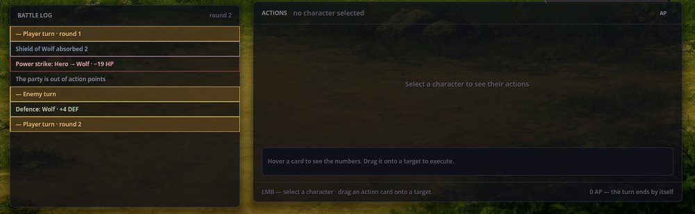

# Card Battle — бои, где карты перетаскивают на цели

Card Battle — боевая система, в которой персонажи — крупные карты, а их действия — карты поменьше: выберите персонажа и перетащите одну из его карт действий на цель. Это боевая система Cthangover, а RPG Plus может играть в неё вместо FF Battle. Сам бой — начало, фон, экраны победы и поражения, опыт и добыча — берётся из Turn Battle Base.

## Экран боя

Воин из RPG Plus против волка: герой нажат, курсор наведён на Power strike:


- **Карты персонажей** показывают здоровье (HP), щит (DEF, поглощает урон первым), атаку (ATK) и очки действий (AP).
- **Панель Actions** — карты действий выбранного персонажа: цель (враг или союзник), стоимость в AP и значения. Карту, которую персонаж не может оплатить, видно приглушённой.
- **Строка подсказки** под картами объясняет, что сделает карта под курсором: урон для обычной атаки, щит для защиты, описание — для навыка, записанного формулой.
- **End turn** завершает ход отряда досрочно; когда AP кончаются (0), ход завершается сам.

## Ход

1. **Нажмите карту члена отряда**, чтобы увидеть его действия.
2. **Перетащите карту действия на цель** — карту врага для атаки, карту союзника для защиты. Цель подсвечивает, применимо ли к ней действие.
3. Когда у отряда кончаются очки действий, ходят враги, и начинается новый раунд.



Power strike героя снял 21: первые 2 поглотил щит волка, а здоровье упало на 19 — с 31 до 12. После этого волк поднял щит до 4.

## Действия

В Card Battle работают те же базовые виды действий, что и в FF Battle:

- `Attack=1.5` — урон атаки, умноженный на число; первым его поглощает щит цели;
- `Defence=4` — щит на союзнике;
- `Turn=2` — оглушение на столько ходов.

Навыки, записанные формулами (значения `Formula=`, например Power strike из Classic RPG Rules), тоже работают здесь — через Battle Formulas.

## Как включить Card Battle

В коллекции игры задайте `"battle.core": "card_battle"`, либо переключите систему сценарием до боя:

```scenario
action battle.set_core core=card_battle
```

## Если что-то пошло не так

1. **Перетаскивание карты ничего не делает.** Не выбран персонаж, у него не хватает очков действий либо цель с другой стороны (атаки — на врагов, защиты — на союзников).
2. **Бой открывается в FF Battle.** В настройке игры `battle.core` прописан `ff_battle`.
