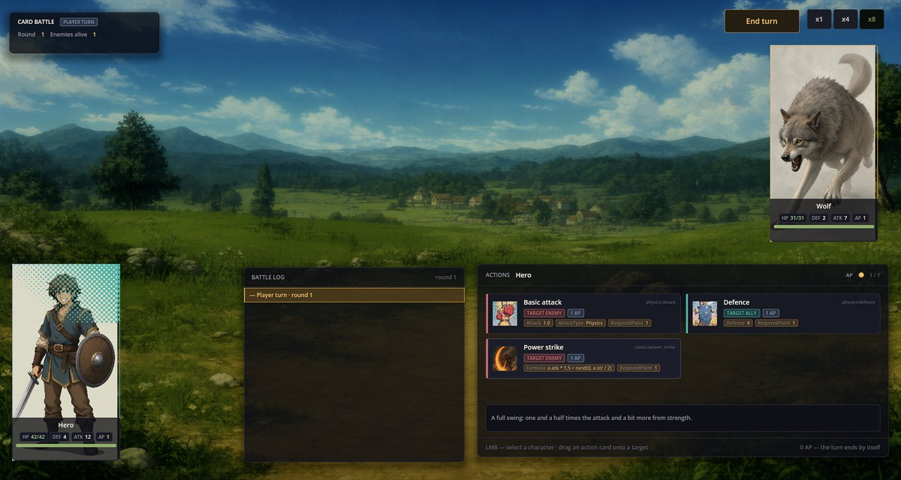

# Card Battle —— 把卡牌拖到目标上进行战斗

Card Battle 是一套战斗系统：角色是一张张大的卡牌，他们的动作则是更小的卡牌——先选中角色，再把一张动作卡拖到目标上。它是 Cthangover 的战斗系统，RPG Plus 也可以用它替代 FF Battle。而战斗本身——发起、背景、胜利与失败画面、经验和掉落——都来自 Turn Battle Base。

## 战斗画面

RPG Plus 的战士对阵狼：点击英雄后，光标悬停在 Power strike 上：



- **角色卡**显示生命（HP）、护盾（DEF，优先吸收伤害）、攻击（ATK）和行动点（AP）。
- **Actions 面板**——所选角色的动作卡，标明目标（敌人或队友）、AP 消耗和数值。角色付不起的卡会变暗。
- 卡片下方的**提示行**说明鼠标所指卡片的效果：普通攻击显示伤害，防御显示护盾，公式技能则显示描述。
- **End turn** 可提前结束队伍回合；AP 用到 0 时回合会自动结束。

## 一个回合的流程

1. **点击队伍成员的卡牌**，查看其可用动作。
2. **把动作卡拖到目标上**——攻击拖到敌人卡上，防御拖到队友卡上。目标会显示该动作是否适用于它。
3. 队伍的行动点用完后，敌人开始行动，新一轮开始。


英雄的 Power strike 打出 21 点：狼的 2 点护盾先被消耗，生命随之下降 19，从 31 降到 12。随后狼把护盾提升到 4。

## 动作类型

Card Battle 执行与 FF Battle 相同的几种基础动作：

- `Attack=1.5`——攻击伤害乘以该数值；优先被目标的护盾吸收；
- `Defence=4`——给队友加护盾；
- `Turn=2`——眩晕相应的回合数。

以公式书写的技能（`Formula=` 值，比如 Classic RPG Rules 的 Power strike）经由 Battle Formulas 在这里同样有效。

## 选择 Card Battle

在游戏的合集设置中写入 `"battle.core": "card_battle"`，或者在战斗前用剧本切换：

```scenario
action battle.set_core core=card_battle
```

## 出问题怎么办

1. **拖动卡牌没有反应。** 可能没有选中角色、角色的行动点不足，或者目标阵营不对（攻击拖到敌人身上，防御拖到队友身上）。
2. **战斗以 FF Battle 打开。** 游戏的 `battle.core` 设置指定的是 `ff_battle`。
